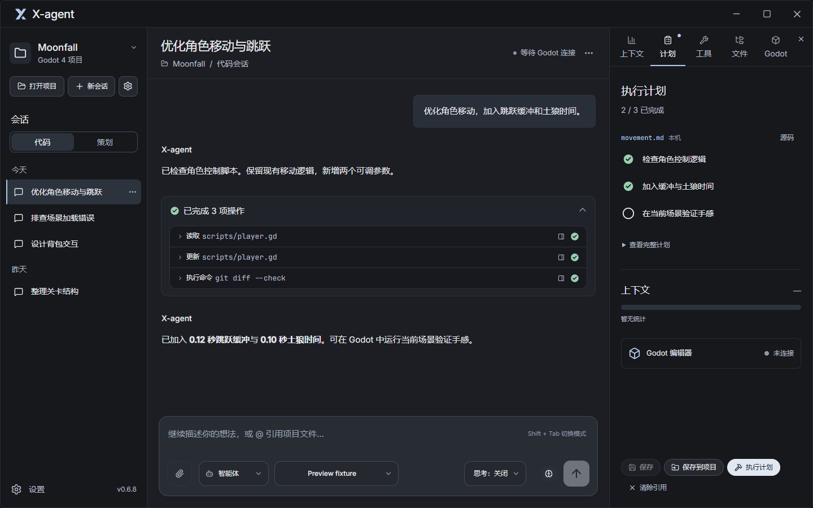
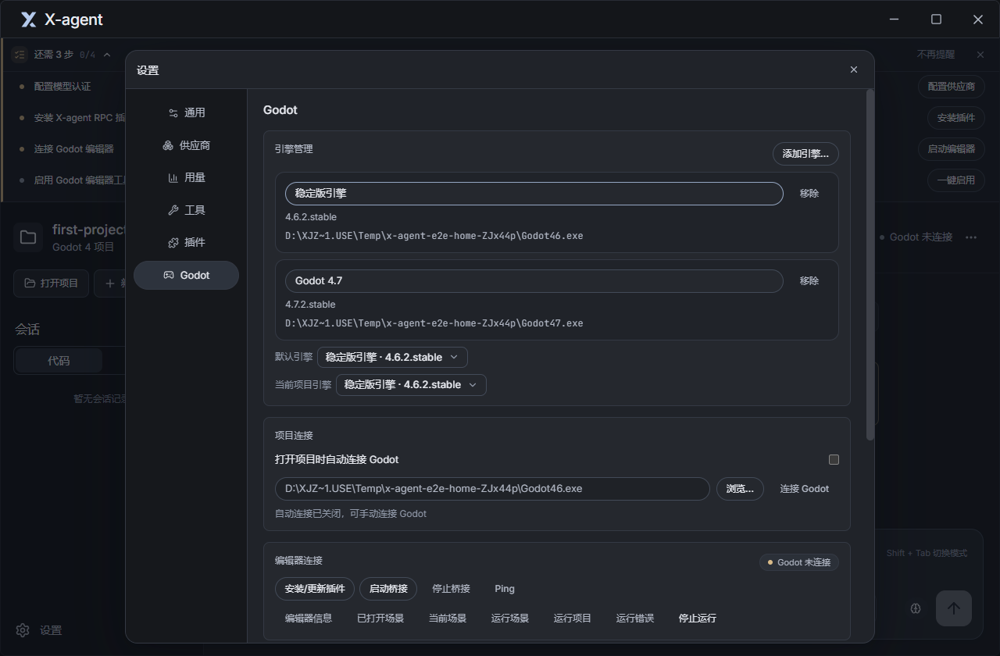

<h1 align="center">X-agent</h1>

<p align="center">面向 Godot 4 的桌面 AI 开发助手</p>

<p align="center">
  <a href="https://github.com/Fromlan/X-agent/releases/latest"></a>
  
  <a href="LICENSE"></a>
</p>

<p align="center">
  <a href="https://github.com/Fromlan/X-agent/releases/latest">下载</a> ·
  <a href="#开始使用">开始使用</a> ·
  <a href="#功能">功能</a> ·
  <a href="#从源码运行">开发</a> ·
  <a href="https://github.com/Fromlan/X-agent/issues">反馈</a> ·
  <a href="README.en.md">English</a>
</p>

X-agent 让你在同一个会话里修改 Godot 项目的脚本和场景、调用编辑器、查看运行报错。动手前可以先调研和制定计划，也可以单独开一个策划会话，整理玩法、系统和数值文档。

客户端基于 [Pi SDK](https://pi.dev) 构建，使用你配置的模型和认证。项目仍处于 Beta 阶段，目前提供 Windows 安装包，界面语言为中文。

<p align="center">
  
</p>

## 开始使用

从 [GitHub Releases](https://github.com/Fromlan/X-agent/releases/latest) 下载 `X-agent-Setup-<版本>-<架构>.exe`，按安装向导操作。安装版会在启动后检查更新，下载和安装由你确认。

准备好 Godot 4 和 [Git for Windows](https://gitforwindows.org/)。Git 提供命令执行所需的 Bash，也用于保存工作区检查点。Pi 登录和技能包安装还需要 Node.js 24+ 与 Pi CLI，可按应用内的就绪检查提示安装。

1. **打开项目**：选择包含 `project.godot` 的工程根目录。
2. **配置模型**：在「设置 → 供应商」添加并启用供应商配置；也可以在「设置 → 通用」打开 Pi 登录，复用本机已有认证。
3. **终端自动就绪**：应用启动时自动发现并配置已安装的 Git Bash，保留有效的自定义路径；仅在找不到 Bash 或配置失败时提示处理。
4. **开始对话**：在输入区选择模型和工作模式，描述要完成的事情。

### 连接 Godot 编辑器

连接后，Agent 可以读取当前场景、运行项目并获取报错。

1. 打开 Godot 项目后，X-agent 默认自动连接已有编辑器，或自动查找引擎、安装并启用插件后打开项目。
2. 在「设置 → Godot → 引擎管理」添加多个版本、设置默认引擎，并为当前项目选择专用版本。项目选择独立保存，旧引擎路径会自动迁移；默认及自动检测会检查项目版本与 C# 支持。
3. 如果 Godot 已打开但尚未加载插件，按提示启用 **X-agent RPC** 或保存后重新打开项目。确认状态为「已连接」；可在设置中关闭自动连接或手动重试。
4. 在「设置 → 工具」勾选需要使用的 **Godot 编辑器工具**。这些工具默认关闭。



具体工具和连接排查见 [Godot 插件文档](packages/godot-editor-rpc/README.md)。

## 功能

### 在对话里操作 Godot

目前提供 **27 个 Godot 工具**，覆盖场景与节点查询、场景打开与重载、运行与报错收集、脚本检查、资源导入和导出等操作。连接多个编辑器时，可以在设置中选择活动编辑器。

原生技能包包含 `godot-docs-4-7` 文档知识库，在 Godot 项目中按需加载。技能包内容与安装方式见 [godot-pi](packages/godot-pi/README.md)。

### 先调研、做计划，再执行

代码会话提供四种工作模式，在输入区切换，也可以按 `Shift+Tab` 轮换。

| 模式 | 工作方式 |
|---|---|
| 智能体（Agent） | 读取和修改项目文件，调用已启用的工具，执行开发任务。 |
| 调研（Ask） | 只读查看项目、查询资料和回答问题，禁止文件写入，终端仅允许项目内的只读命令。 |
| 计划（Plan） | 只读研究并生成计划，在右栏查看、编辑或保存；点击「执行计划」后进入智能体模式。 |
| 目标（Goal） | 按完成条件执行，由独立评估判断是否继续，受轮次和 Token 预算约束。 |

目标模式的预算用于控制续轮，包含评估开销；单次请求可能超出预算。是否完成仍需结合测试和实际运行结果判断。

### 查看改动与撤回

每轮结束后可以查看文件 Diff，也可以撤回、编辑原消息后重发，或重新生成回复。撤回前会展示将被还原的内容。

有 Git 时，应用使用独立的 Shadow Git 仓库保存检查点，不改动项目的 Git 历史；没有 Git 时，降级记录 `write` / `edit` 工具的文件基线。撤回只还原相关变更路径，保留 Agent 未触碰的文件。同一文件里的人工修改仍可能受还原影响，撤回前请检查 Diff。

### 单独整理游戏策划

在侧栏选择「策划」并新建会话，可以参考项目代码编写设计文档，写入范围限定在项目的 `game-design/` 目录。内置技能涵盖立项、设计流程、系统、数值和核心循环；切换工作模式不会解除策划目录的写入限制。

### 引用文件、图片和网页

输入 `@` 可引用项目文件，输入 `/` 可选择技能、提示词和命令；图片与文件支持粘贴或拖放，图片输入需要所选模型支持。

网页搜索与抓取使用 DeepSeek 官方接口，可供不同聊天模型调用：先在「设置 → 供应商」配置并启用 DeepSeek 官方供应商，再到「设置 → 工具 → DeepSeek 网络」选择该配置，开启网页搜索或网页抓取。两项默认关闭，搜索词和目标网址会发送给 DeepSeek，请求单独计费，暂不计入应用的模型 Token 费用统计。

### 模型、扩展与工作台

供应商配置支持导入本机 Pi 和 cc-switch 配置，可切换模型、调整思考档位，并按日、按模型查看用量。设置内可以管理 Pi 的技能、提示词、扩展、主题和 Packages。

右侧面板提供上下文占用与压缩、计划、工具和文件浏览。外观可在石墨、雾蓝、暮紫、暖砂、松绿和高对比主题之间选择，支持深浅模式。

## 安全与隐私

会话、偏好、用量和检查点保存在本机 `%USERPROFILE%\.pi\agent\` 下。`auth.json`、`models.json`、`settings.json` 与 Pi CLI 共用；X-agent 会话和检查点分别放在 `x-agent/sessions/`、`x-agent/checkpoints/`。

模型请求会把对话和需要的项目上下文发送给你选择的供应商。供应商档案中的 API Key 尽量使用系统加密存储，启用后也会以明文写入 Pi 的 `auth.json`。

智能体和目标模式可以写文件、运行命令。内置文件工具限制在项目目录内，但 Bash 仍可能访问更广的本机路径，不能把这些限制视为操作系统级沙箱。Godot 连接仅监听本机 `127.0.0.1`，并校验连接令牌。

配置和实现细节见 [开发参考](docs/agent.md) 与 [上下文说明](docs/agent-context.md)；报告安全问题请阅读 [SECURITY.md](SECURITY.md)。

## 从源码运行

开发和 CI 目前均以 Windows 为准，需要 Node.js 24+ 和 Git for Windows。依赖与锁文件位于 `apps/desktop`，在 PowerShell 中运行：

```powershell
git clone https://github.com/Fromlan/X-agent.git
cd X-agent/apps/desktop
npm ci
npm run dev
```

在 `apps/desktop` 目录执行检查：

```powershell
npm run typecheck
npm run lint
npm test
npm run test:coverage
npm run build
npm run test:e2e
```

真实 Godot 集成测试需要将 `$env:GODOT_BIN` 设为 Godot 4.7.2 console 可执行文件的绝对路径，再运行 `npm run test:godot`。文档修改还需在仓库根目录运行 `npm run doc:drift` 和 `npm run test:doc-drift`。

仓库中的 `apps/desktop` 是 Electron 客户端，`packages/godot-editor-rpc` 是 Godot 插件，`packages/godot-pi` 是原生技能包。架构与开发约定见 [CLAUDE.md](CLAUDE.md)，贡献流程见 [CONTRIBUTING.md](CONTRIBUTING.md)。

## 反馈与贡献

遇到问题或有功能建议，可以提交 [Issue](https://github.com/Fromlan/X-agent/issues)。请附上版本、Godot 版本、所用模型与复现步骤。「设置 → 通用 → 诊断与反馈」可以预览、导出本地诊断信息或复制反馈摘要；诊断不包含对话、源码、路径和密钥，也不会自动上传。

欢迎提交 PR。较大的改动请先开 Issue 讨论，参与前请阅读 [贡献指南](CONTRIBUTING.md) 和 [行为准则](CODE_OF_CONDUCT.md)。版本变化见 [更新日志](CHANGELOG.md)，后续计划见 [路线图](docs/roadmap.md)。

联系：[fromlan@qq.com](mailto:fromlan@qq.com) · QQ 群：`1074500101`

## 致谢与许可

X-agent 基于 [Pi SDK](https://pi.dev) 构建，使用 [thinking-orbs](https://github.com/JakubAntalik/thinking-orbs) 状态动画，Godot 知识库整理自 [Godot 官方文档](https://docs.godotengine.org/)。

本项目采用 [MIT License](LICENSE)。
